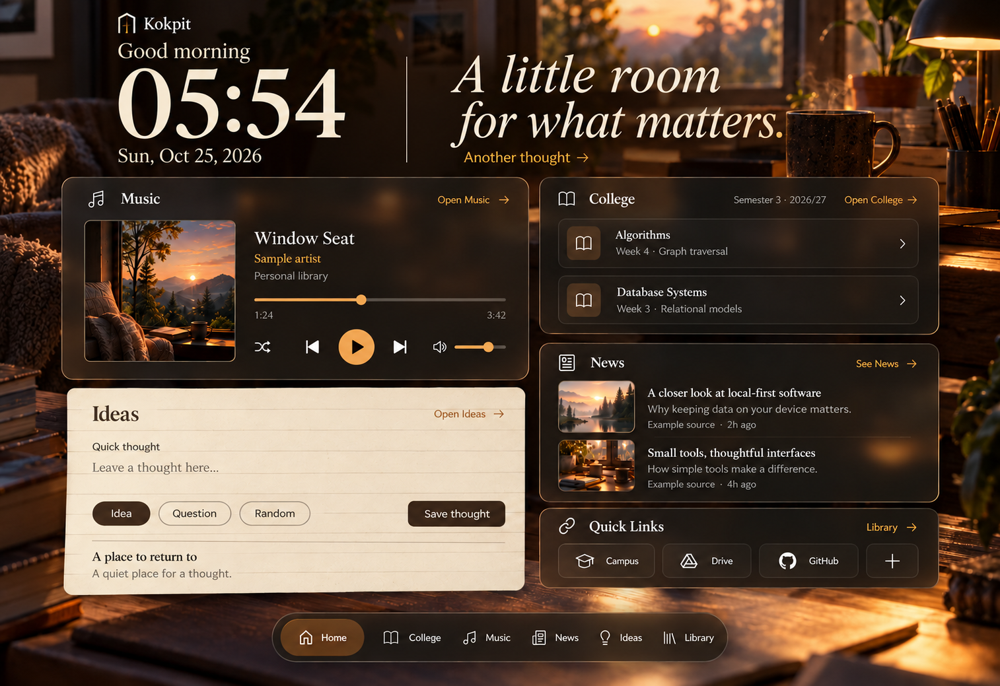
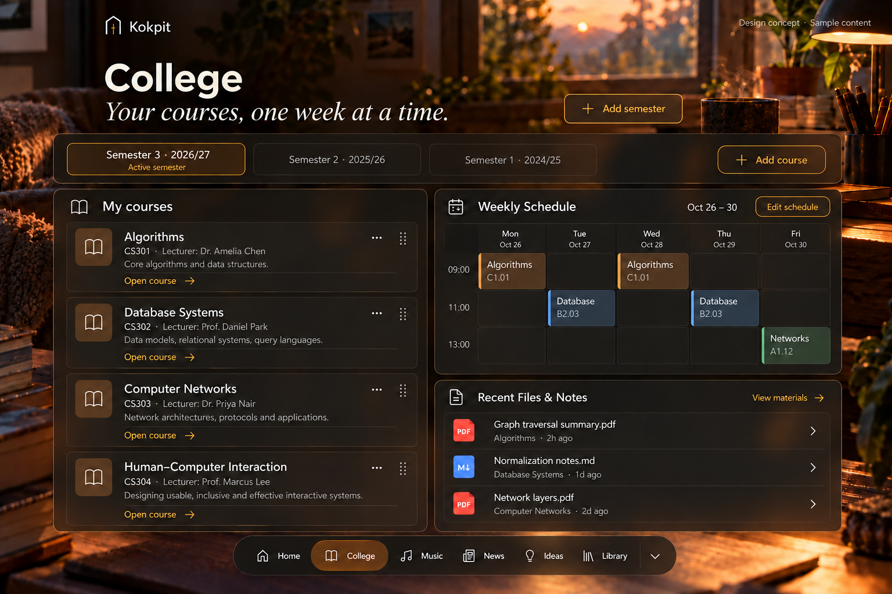
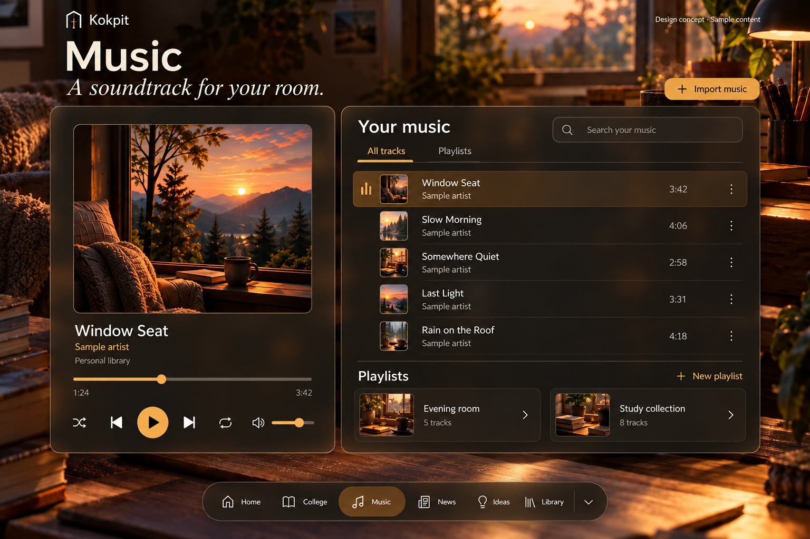
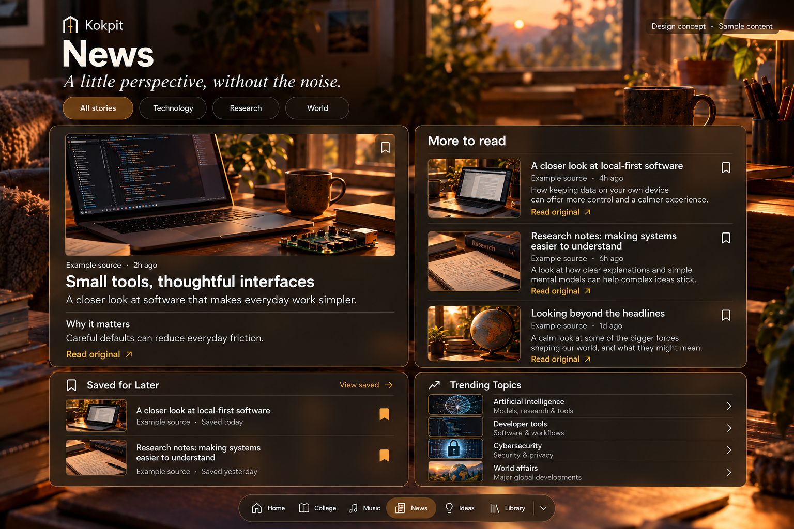
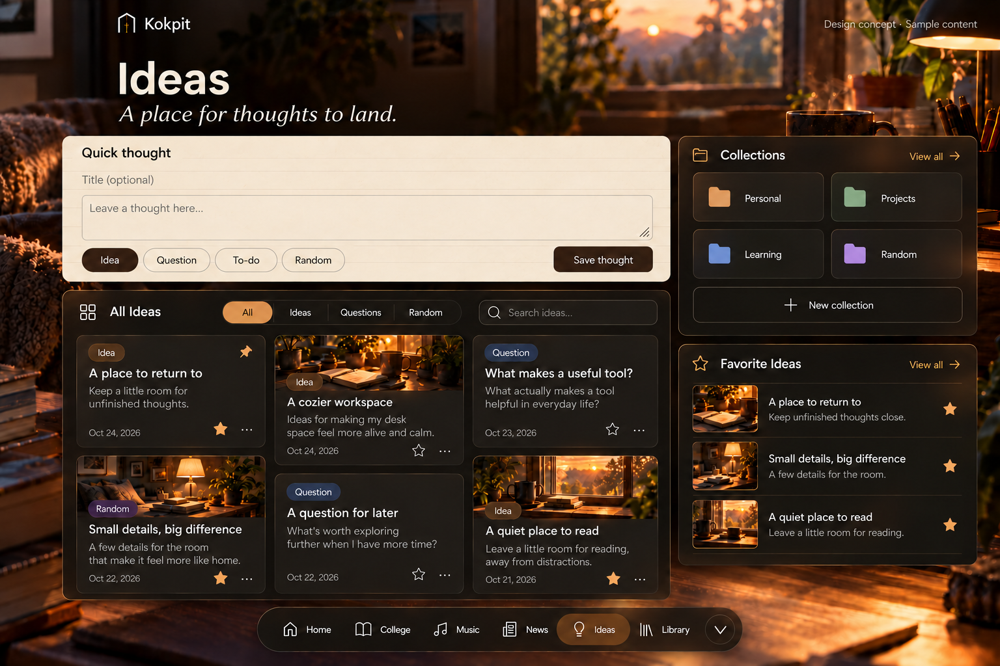
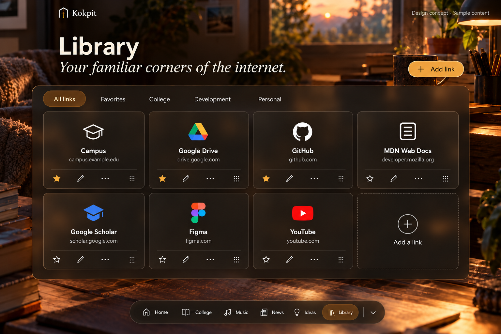

# Kokpit UI references

**Version:** 1.2 | **Status:** Owner-approved references | **Updated:** 2026-10-25

The owner approved FINAL Home plus the five feature-page images below and requested
working behavior for every visible feature control. These are the current visual targets.
[Design System](DESIGN_SYSTEM.md) normalizes typography, tokens, spacing and accessibility;
[PRD](../product/PRD.md) and [Approved UI Features](../features/APPROVED_UI_FEATURES.md)
define behavior. [Implementation Plan](../planning/IMPLEMENTATION_PLAN.md) defines delivery.

Approval of an image does not mean its features have been implemented. All sample personal
records, headlines, dates, rooms, artists and photos are illustrative, not production seed data.

## Selected references

| Page | Authoritative image | Direction |
| --- | --- | --- |
| Home | [home-final.png](references/home-final.png) | Implemented warm room, clock/quote, translucent panels, paper capture and shared hideable dock. |
| College | [01-college-v2.png](concepts/2026-10-25/01-college-v2.png) | Semester selector, courses, recurring Weekly Schedule and Recent Files & Notes. |
| Music | [02-music.png](concepts/2026-10-25/02-music.png) | Player/artwork at left, real library/search/playlists at right. |
| News | [03-news-v2.png](concepts/2026-10-25/03-news-v2.png) | Lead/feed, bookmark actions, Saved for Later and derived Trending Topics. |
| Ideas | [04-ideas-v2.png](concepts/2026-10-25/04-ideas-v2.png) | Paper composer, All Ideas grid, Collections and Favorite Ideas. |
| Library | [05-library.png](concepts/2026-10-25/05-library.png) | Shortcut portal grid, groups/favorites, add/edit/delete/reorder. |

Music and Library retain their selected first concepts. College, News and Ideas use the
approved revised versions. Superseded initial concepts, earlier Stitch PNGs and proposal-only
notes were removed at the owner's request. Decision history is retained in
[DEC-051, DEC-053 and DEC-054](../product/DECISIONS.md); old images are no longer build targets.
The source gallery remains named concepts for path stability, but its README records approval.

## Interpretation

- Use the same room atmosphere and six-route dock everywhere. No sidebar or browser frame.
- Keep Cormorant Garamond for clock/quote/expressive text; use Inter for functional titles,
  controls, course names, article/idea text and metadata, even where a generated image differs.
- Use semantic tokens and readable foreground surfaces. Avoid glow, heavy blur and repeated
  nested borders. Real content may expand; do not squeeze panels to force a no-scroll viewport.
- Preserve Home's two columns with aligned lower edges and its mobile DOM/keyboard order.
- Schedule is a recurring owned-course timetable, not general calendar sync/events/tasks.
  Recent notes are existing uploaded study materials, not a separate notebook editor.
- Trending describes the last seven days of Kokpit's feed, not global popularity. Saves keep
  original article references through cleanup, not full publisher pages or reading metrics.
- Collections are flat optional groups; favorite stars are distinct from pins. Idea images are
  optional private covers with a text-only fallback, not an AI/remote attachment workflow.
- Every View all/New/Edit/menu/star/drag affordance must have documented real behavior and
  keyboard access when its package ships. Do not add unrelated controls merely from older references.
- Compare desktop captures with the relevant image, then verify mobile reflow, long/empty/error
  content, draft recovery and focus. Static PNGs do not prove those states work.
- Reference PNGs are documentation, never rendered as a functional screenshot in the application.
  The separate clean public room photograph remains the runtime decorative asset.

## Gallery

### Home

### College

### Music

### News

### Ideas

### Library

