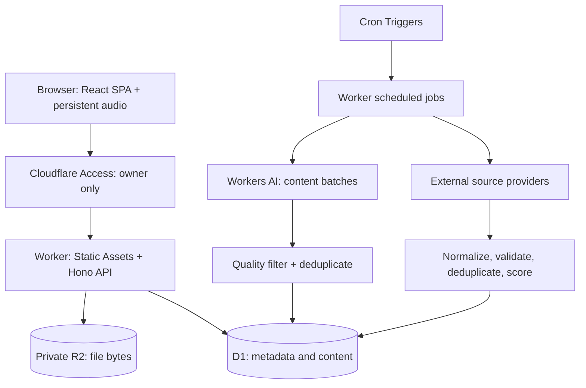
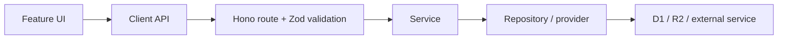
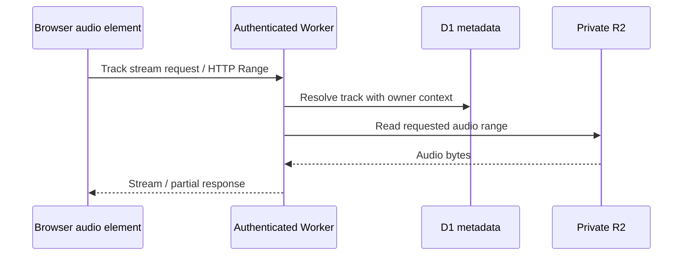

# Kokpit — Architecture

**Version:** 0.9 · **Status:** V1 architecture and approved pending extensions · **Updated:** 2026-10-26

Private single-user workspace, one repository, one logical Cloudflare deployment.
This document owns system boundaries; it does not redefine product or visual requirements.

| Source | Responsibility |
|---|---|
| [PRD](../product/PRD.md) | Product and V1 scope |
| [Design System](../design/DESIGN_SYSTEM.md) | Visual tokens and interaction rules |
| [Data Model](DATA_MODEL.md) | Persisted entities, fields and relationships |
| [Content Sources](../features/CONTENT_SOURCES.md) | Quotes, news and provider strategy |
| [File Structure](FILE_STRUCTURE.md) | Directory responsibilities |
| [Deployment](DEPLOYMENT.md) | Environments, bindings, migrations and operations |
| [Implementation Plan](../planning/IMPLEMENTATION_PLAN.md) | Authorized milestone/work package boundaries |
| [AGENTS.md](../../AGENTS.md) | Mandatory workflow and source precedence |

## Locked stack

| Layer | V1 choice |
|---|---|
| Client | React + strict TypeScript + Vite; SPA without SSR |
| Navigation | React Router |
| Styling | Tailwind CSS + Kokpit CSS custom properties |
| Server state | TanStack Query |
| Session/UI state | React Context or a small local store |
| HTTP runtime | Cloudflare Workers + Hono + TypeScript |
| Boundary validation | Zod |
| Structured storage | Cloudflare D1 + Drizzle ORM |
| File bytes | Private Cloudflare R2 |
| Private gate | Cloudflare Access |
| Background jobs | Cloudflare Cron Triggers |
| Content AI | Workers AI; cached/batched, optional to basic functionality |
| Deployment | Workers + Static Assets through Cloudflare Vite integration |

Baseline packages 1.1–3.3 are implemented: Cloudflare Vite integration, the D1 schema/local
migration, owner context, safe Hono APIs, the responsive shell/Home, Ideas and
Quick Links. The frontend uses Kokpit tokens/fonts with Tailwind utilities and
explicit base styles, without Preflight. Package 4.1 adds owner-scoped College
hierarchy APIs through routes, a service and a repository using the existing schema.
Package 4.2 adds lazy College, course and week pages, shared query-backed Home
context and metadata forms. Package 4.3 adds local private R2, streamed file uploads,
material metadata/link APIs and owned file delivery. Package 4.4 adds material UI, recent/full lists
and coordinated R2/metadata deletion. The class timetable, persistent audio,
content jobs and production resources remain pending.
DEC-054 approves feature-page requirements, including class schedule, Ideas collections/
favorites/covers and News saves/topics. They use the same stack and domain boundaries;
they are not implemented by the documentation approval. The Data Model distinguishes
the existing 17-table baseline from the 20-table target.
Production frontend and `/api/*` share an origin and deploy together.
Use Workers Static Assets, not legacy Workers Sites.



## Frontend composition

Feature boundaries are `home`, `college`, `music`, `news`, `ideas`, `library`.
Feature code starts in `src/features/`; shared primitives in `src/components/`;
application composition in `src/app/`; generic infrastructure in `src/lib/`.
Move code to shared only after a second genuine use.

React Router keeps the shell, shared bottom navigation, providers and future music engine
mounted across navigation. The owner-approved FINAL visual polish replaces the sidebar
with a six-link floating dock on every route. `AppShell` owns the shared room background,
readability treatment and content clearance; layout owns `BottomNavigation` and its
navigation items. Feature routes retain their existing responsibilities and APIs.
Conceptual page routes (exact supporting route names are implementation details):

| Page | Route |
|---|---|
| Home | `/` or `/home` |
| College | `/college` |
| Music | `/music` |
| News | `/news` |
| Ideas | `/ideas` |
| Library | `/library` |

College may nest semester/course/week paths; Music may nest playlist paths.
Current College routes are `/college`, `/college/courses/:courseId` and
`/college/weeks/:weekId`; `?semester=<id>` preserves the overview selection.
Package 4.4 adds `?view=materials` to the semester overview; pending News/Ideas views
use validated feature-local query parameters from Approved UI Features. These additions
do not create more primary destinations or an alternate global navigation system.
Lazy-load deeper feature routes where useful. Home reads lightweight summaries from their
own modules; it must not import complete College management or Music library functionality.

Use custom lightweight components, native semantic controls and Lucide where needed.
Tailwind utilities must reference semantic Kokpit tokens, not establish a second raw palette.
No pre-styled theme or large UI framework is required.
Accessibility and loading/empty/error states follow the Design System.

| State | Owner |
|---|---|
| Ideas/collections/favorites, links, College/class schedule, music, playlists, news/saves, quotes, settings | API + D1; TanStack Query fetch/cache/invalidate |
| Playing track, queue, volume, player events | Persistent client provider above routes |
| Selections, modal/form state | Local React state/context |
| Small non-critical preferences | Browser storage where appropriate |

LocalStorage is not a database for content, files, playlists or news.
No Redux is needed. Do not continuously persist audio position or clock ticks.

The shared dock's visibility remains session-only React state. Schedule entries, collection
membership, favorites and article saves survive reload through D1, not localStorage.
Invalidate related feature queries/previews after writes; never reset an unrelated draft or
remount the audio provider when switching filters, collections or saved views.

## HTTP and business logic

Use a same-origin JSON REST API with predictable status codes and Kokpit-owned contracts.
Explicit `/api/v1` versioning is unnecessary while private client and API deploy together.
The browser never directly queries D1 or receives privileged provider/storage credentials.



Simple operations need only the layers that clarify responsibility; avoid ceremony.
Related idea/tag writes and complete link reorder writes use atomic D1 batches.
Expected tag conflicts are handled with targeted upserts, not suppressed write errors.
Hono owns HTTP routing, not large embedded business workflows.
External provider logic belongs in `worker/providers/`, normalized before database/API use.
Drizzle schema and queries belong in the database layer; focused raw SQL is acceptable.

Conceptual API groups include system, quotes, news, ideas, links, College hierarchy,
materials, tracks, playlists and files. Exact endpoint names can be simplified during implementation.
Validate route/query parameters, request bodies, URLs, filenames, file metadata, MIME claims
and external feeds with Zod. Never trust browser or provider input.

Errors use structured safe JSON, for example:

```json
{"error":{"code":"RESOURCE_NOT_FOUND","message":"Material not found."}}
```

Do not expose stack traces, SQL internals, secrets or Cloudflare credentials.
Feature errors remain local and recoverable where possible.

## Identity and authorization

V1 has one seeded owner. Cloudflare Access is the private gate: deny by default,
allow the owner identity only, using permitted email/One-Time PIN or an identity provider.
There is no custom login, registration, account switching, team or public profile in V1.
A secret URL or obscure hostname is not security.

Access covers frontend, API and file/audio routes. It does not replace application authorization:
resolve owner context and scope every personal resource lookup by `user_id`, including nested resources.

```sql
SELECT * FROM ideas WHERE id = ? AND user_id = ?;
```

Keep ownership on security-sensitive records even when inferable through a parent.
Future public accounts would require a separate authentication review; data readiness does not authorize public behavior.

## D1, R2 and uploads

D1 stores metadata and relationships. R2 stores audio, artwork, College PDFs/slides/documents/images.
The [Data Model](DATA_MODEL.md) defines the implemented 17-table baseline and approved
20-table target. New fields/tables require later additive migrations, not edits to applied SQL.

- Keep R2 private; no unrestricted browser bucket access or public file URLs.
- Generate object keys in the backend; never trust complete keys supplied by clients.
- Store original filename separately for display; sanitize untrusted names.
- Upload through the Worker to R2 for V1 simplicity.
- Enforce **50 MB per file**; validate allowed type, declared/actual size, metadata and destination ownership.
- Large-file presigned/multipart flows are future work requiring a real need and review.

File access resolves metadata → verifies ownership → reads R2 → streams bytes.
A conceptual file route is `GET /api/files/:id`; guessing an object key grants no access.
Keep replacement and deletion consistent across storage layers; follow canonical lifecycle rules in Data Model.
SQL cascades cannot remove R2 bytes. Retry partial cleanup safely and avoid orphan accumulation.

Package 4.3 uses raw file request streams with validated filename/declared size plus actual
byte counting, bounded signature/text checks and native FixedLengthStream for R2. Successful
metadata is inserted only after storage; ambiguous D1 failure is resolved before attempting
compensation. Preserve referenced bytes when metadata recovery is unavailable or ancestry
becomes inaccessible. Cleanup failures log a safe operation/material ID for reconciliation.
The concrete protocol, safe download headers, Range behavior and deletion lifecycle are in
[College Materials](../features/COLLEGE_MATERIALS.md). No new storage provider/dependency
or public bucket URL is introduced. Package 4.4 deletes owned objects before metadata, checks
inaccessible descendants before hierarchy cleanup, and preserves final SQL guards against
concurrent file additions. Partial cleanup is explicit and retryable; D1/R2 do not share a transaction.
Feature-local TanStack Query lists refresh after material writes and failed hierarchy cleanup.
Native authenticated links stream files without buffering them in React or storing bytes in localStorage.

Ideas covers reuse the private R2 provider and owner-checked byte delivery. Store only cover
metadata in D1; validate JPEG/PNG/WebP bytes, size and bounded thumbnail dimensions. Cover
replace/remove/delete uses the same rollback and partial-cleanup discipline as material files.
No private cover URL, object key or idea content goes to quote/news AI or an image provider.

## Approved feature extensions

The interaction/API checklist is [Approved UI Features](../features/APPROVED_UI_FEATURES.md).

| Domain | Service/repository responsibility |
|---|---|
| College schedule | Owned recurring class entries under courses; validate semester ancestry, local weekday/time bounds, duplicates and deletion. Render in saved owner timezone; no external calendar service or recurrence engine. |
| Recent materials | Bounded query joining materials → weeks → courses → selected semester with ownership at every level. Sort by updated time/ID; reuse authenticated file/link access. No view-tracking job or new activity table. |
| Ideas collections/favorites | Flat optional collection FK and independent isFavorite/isPinned flags; collection delete clears membership without deleting ideas or covers. Atomic reorder and safe cross-owner relationship checks. |
| News saves | Owner-scoped reference relation; project isSaved for the current owner without mutating the shared article or leaking private state through a shared HTTP cache. |
| Feed topics | Deterministic primary topic during normalization, then aggregate eligible seven-day cache on the server. No new trend provider, per-load AI or count table. |

Article cleanup performs a guarded delete excluding saved references; restrictive FKs protect
retained records. Disable sources rather than hard-delete rows still needed by saves.
Keep cache-only feed/topic reads usable during provider failure. Use bounded lists and stable
ID tie-breakers, with complete managers beyond preview limits. Existing Ideas limit/offset
APIs remain compatible when new filters are added.

## Persistent music

Use native `HTMLAudioElement` capabilities; no custom codec engine.
The provider lives above routed pages so navigation does not interrupt playback.



Support HTTP Range requests for seeking, stream rather than preload full files.
V1's core is owned uploads, library, playlists and playback.
Unofficial YouTube/TikTok/Instagram scraping is not a core dependency;
future external imports must be reliable, legally appropriate and optional.

## Content pipelines

The same Worker exposes `fetch()` for requests and `scheduled()` for jobs.
Cron refreshes news, refills a low quote pool and cleans stale content;
not every job must run on every invocation. Avoid separate Workers without operational need.

| Pipeline | Required behavior |
|---|---|
| News | Approved source adapters → normalize → validate → deduplicate → relevance score → optional AI → D1 → API |
| Quotes | Workers AI batch → quality filter → deduplicate → D1 pool → stable local-hour selection API |

News providers, accepted feeds, relevance inputs and schedules remain in Content Sources.
Initial refresh is 30–60 minutes; Deployment recommends a 30-minute base Cron.
Keep original source URLs. AI may summarize/classify/explain relevance, but source headline,
description and basic scoring must work without it. Filter first, enrich selected top articles second.
Source failures must preserve cached articles and allow other sources to continue.

Quotes target approximately 90% English / 10% Indonesian and normally have no AI author.
No fabricated attribution, generic motivational array, or AI call on every page load.
Select by `user_settings.timezone`; primary quote changes at local clock-hour boundaries and remains stable within the hour.
The required secondary `another thought` action does not replace the scheduled primary selection.
Fallback order: eligible cached quote → previously stored quote → small emergency set.
The fallback pool is for reliability, not the primary experience.
Workers AI receives only approved general context, never private ideas, notes, files or listening history.

## Reliability, caching and performance

| Failure | Isolation |
|---|---|
| AI unavailable/quota exhausted | Cached quotes and basic news remain usable |
| One malformed/down feed | Other sources still refresh |
| File upload fails | Unrelated features remain usable |
| News refresh fails | Render existing normalized cache |

Use static asset caching, D1 news/quote pools, frontend query cache and appropriate browser HTTP cache.
Private responses must preserve Access/ownership boundaries; do not create shared cache paths that leak personal data.
No KV is required without demonstrated benefit.
Keep Home fast, use thumbnails, lazy feature routes, streamed audio and minimal dependencies.
Clock uses client timers, progress uses audio events; neither needs realtime infrastructure.

Log unexpected API failures, job/source failures and file-operation failures through native Worker logs.
Never log private contents, tokens, secrets, signed URLs or audio/document bytes.
Third-party observability infrastructure is unnecessary in V1.

## Environments, changes and recovery

Support local and production; preview/staging only when risk justifies it.
Cloudflare tooling should emulate local bindings; never require production D1 data for development.
Secrets belong in Cloudflare bindings/Wrangler secrets or ignored local files.
Client environment variables are public; privileged third-party calls stay server-side.

Schema changes use version-controlled migrations, local application and tests before production.
Update Drizzle schema and Data Model for material changes; review compatibility and never rewrite applied history.
Recovery covers D1 native recovery/export, R2 inventory/files, critical configuration and Git.
The operational runbook is [Deployment](DEPLOYMENT.md).

Test pure business logic, critical API/ownership/database behavior, important UI interactions and end-to-end smoke flows.
Priority flows: open Kokpit, save idea, open link, upload material, play/seek audio,
navigate while music continues, and load cached news/quotes.
Run relevant lint, typecheck, build and tests; visually check UI where changed.

## Infrastructure and dependency limits

Prefer fewer moving parts, Cloudflare-native services and low-volume personal costs.
Cache, batch and schedule expensive inference/provider work.
Add a package only when platform/existing APIs are insufficient; avoid duplicate date/state/UI/validation tools.

Excluded without explicit architecture revision: Next.js/SSR, traditional VPS/Node server,
Express, Docker production, Kubernetes, Redis, MongoDB, Firebase, Supabase,
WebSockets, Durable Objects, microservices, message queues and separate search servers.
New databases/ORMs/validators/frameworks require review under AGENTS.md.
Public auth/billing, collaboration, semantic search, embeddings/RAG and larger upload flows are future possibilities, not V1 requirements.
